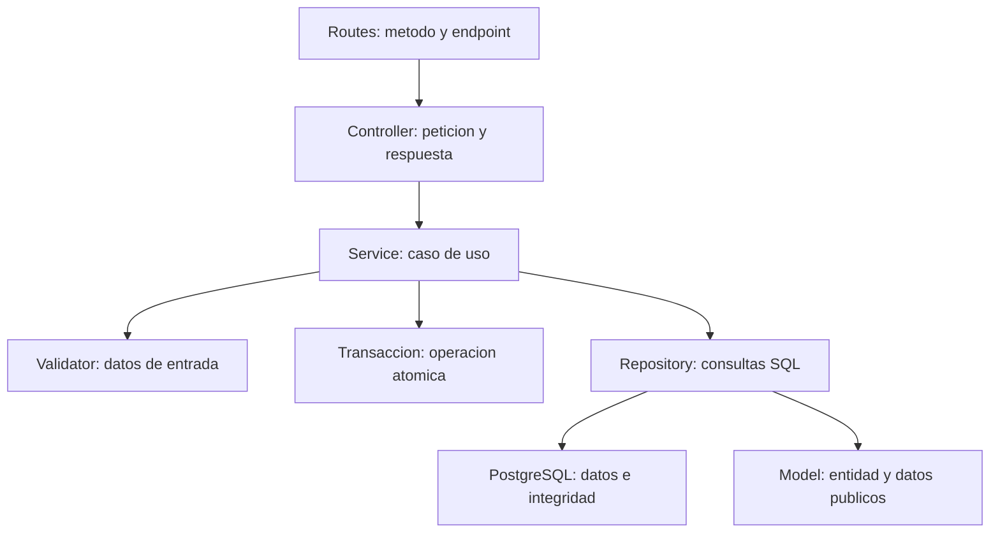

# Clinica Vida Salud: arquitectura y guia para la defensa

**Version 1.5.0.** Base: Sistema-Citas-Medicas-main(2).zip. PHP/PDO/PostgreSQL y frontend existentes.

La logica principal esta en **Services**. Las peticiones llegan primero a Routes y Controllers; despues el servicio coordina validaciones, reglas, consultas y transacciones. Los cambios se aplicaron al codigo, no solamente a la documentacion.

## 1. Que cambio

- Las 56 rutas estan declaradas por modulos. Las rutas ya no construyen servicios, abren PostgreSQL ni envian respuestas.
- `EnrutadorApi` interpreta HTTP, ejecuta los middlewares y llama al controlador. `FabricaControladores` construye sus dependencias y abre la conexion unicamente cuando hace falta.
- `HorarioMedicoService` decide como generar intervalos. `HorarioMedicoRepository` guarda el bloque y `TurnoRepository` guarda o consulta los turnos.
- `DisponibilidadService` y `DisponibilidadController` separan la consulta de oferta de la administracion de horarios.
- Los servicios deciden el alcance del paciente o medico autenticado. Los repositorios reciben esos filtros y ejecutan SQL, sin decidir permisos segun un rol.
- `Transaccion` elimina la repeticion de begin/commit/rollback. **El servicio sigue decidiendo que operaciones pertenecen a una transaccion y que aislamiento necesitan.**
- `HorarioMedicoValidator` y `CitaValidator` separan la validacion de agenda. La fachada `AgendaValidator` conserva compatibilidad con las pruebas y llamadas anteriores.
- `SesionUsuario` encapsula `$_SESSION`; el servicio de autenticacion mantiene las reglas de intentos, credenciales, estado y version de sesion.
- Los nombres de clases y metodos se conservan por responsabilidad; el catalogo enlaza las firmas reales.

Las migraciones 001-005 se conservan. Esta entrega agrega 006-008 y los modulos de consultas, historia y bitacora.

La comparacion detallada esta en [COMPARACION-CADEFAR.md](docs/refactorizacion/COMPARACION-CADEFAR.md). El inventario exacto esta en [ARCHIVOS-MODIFICADOS.md](docs/refactorizacion/ARCHIVOS-MODIFICADOS.md).

## 2. Estructura definitiva

| Carpeta | Contenido |
| --- | --- |
| `backend/public/` | Entrada publica HTTP: `index.php` |
| `backend/src/presentation/routes/` | `RutasApi`, `RutasAgenda` y rutas de Sistema, Autenticacion, Usuarios, Pacientes, Especialidades, Medicos, Horarios, Disponibilidad, Citas, Reportes, Consultas y Bitacora |
| `backend/src/presentation/http/` | `RutaHttp`, `EnrutadorApi`, `FabricaControladores` |
| `backend/src/presentation/controllers/` | Un controlador por modulo; controladores tecnicos de estado y token CSRF |
| `backend/src/presentation/middlewares/` | Origen, sesion, rol y CSRF |
| `backend/src/business/services/` | Autenticacion, Usuario, Paciente, Especialidad, Medico, HorarioMedico, Disponibilidad, Cita Reporte, Consulta, HistoriaClinica y Bitacora |
| `backend/src/business/validators/` | Validadores por modulo y formatos compartidos |
| `backend/src/data/repositories/` | SQL de Usuario, Rol, Paciente, HistoriaClinica, Especialidad, Medico, HorarioMedico, Turno, Cita Reporte, Consulta, HistoriaClinica y Bitacora |
| `backend/src/data/models/` | Entidades y representacion publica de sus datos |
| `backend/src/data/config/` | `ConexionPostgresql` y `Transaccion` |
| `backend/src/data/migrations/` | Migraciones 001-008 |
| `backend/src/data/seeders/` | Datos iniciales para una base vacia |
| `backend/src/shared/` | Configuracion, roles, permisos, errores, sesion y utilidades HTTP |
| `backend/scripts/` | Verificacion del entorno y scripts de migracion/carga |
| `backend/tests/` | Pruebas originales, arquitectura, atomicidad y ejecutor de pruebas |
| `frontend/src/` | `api`, `app`, `components`, `features`, `layouts`, `routes`, `styles` |
| `docs/ai/` | Documentacion previa, contratos y reglas del sistema |
| `docs/refactorizacion/` | Comparacion, cambios, estructura, endpoints y verificacion de esta entrega |

El listado completo de carpetas y archivos esta en [ESTRUCTURA-CARPETAS.md](docs/refactorizacion/ESTRUCTURA-CARPETAS.md).

## 3. Como trabajan las capas



**Routes** indica que controlador y metodo corresponden a una URL. `RutaHttp::roles` usa `null` para una ruta publica, `[]` para cualquier usuario autenticado y una lista para restringir roles. `argumentos` indica que identificadores o usuario autenticado entrega el enrutador al controlador. Esto es configuracion HTTP, no logica clinica.

**Middlewares** comprueba origen, token CSRF, sesion y acceso general por rol. La autorizacion de recursos concretos, como comprobar que una cita pertenece al paciente, permanece en Services. Ocultar un boton no sustituye estas verificaciones.

**Controllers** obtiene JSON, parametros o filtros, llama al servicio y produce la respuesta. No ejecuta SQL, no genera horarios ni decide transiciones de una cita.

**Services** contiene los casos de uso: registrar un paciente completo, crear horarios sin cruces, reservar un turno, cancelar o reprogramar. Llama a Validators y Repositories. Sus metodos reciben datos y entidades, no `$_GET`, `$_POST`, `$_SERVER` ni respuestas HTTP.

**Validators** comprueba tipos, formatos, campos obligatorios, fechas y condiciones de la entrada. La existencia o estado de registros en PostgreSQL se consulta desde el servicio mediante repositorios. Por ejemplo, un identificador valido no significa que el medico exista o este activo.

**Repositories** contiene consultas preparadas, parametros, bloqueos `FOR UPDATE` y transformacion de registros. Las condiciones SQL de disponibilidad filtran lo solicitado por el caso de uso; el repositorio no decide quien esta autorizado ni calcula los intervalos de la jornada.

**Models** representa entidades y sus datos publicos. No es un ORM: PHP usa PDO directamente. No se necesita crear un modelo por cada consulta de reporte o una clase adicional para cada lista de turnos.

**Transaccion** es infraestructura. Abre la transaccion, aplica el aislamiento que solicita el servicio, ejecuta su operacion y confirma o revierte. No decide si un paciente puede reservar. Todas las consultas de una operacion usan el mismo objeto PDO.

## 4. Donde esta cada modulo

Todos los nombres de esta tabla estan dentro de `backend/src/`.

| Modulo | Routes / Controller | Service y Validator | Repositories principales |
| --- | --- | --- | --- |
| Autenticacion | `RutasAutenticacion`, `AutenticacionController`; token en `RutasSistema` / `TokenCsrfController` | `AutenticacionService`, `UsuarioValidator` | `UsuarioRepository` |
| Usuarios y roles | `RutasUsuarios`, `UsuarioController` | `UsuarioService`, `UsuarioValidator` | `UsuarioRepository`, `RolRepository` |
| Pacientes | `RutasPacientes`, `PacienteController`; registro publico en `RutasAutenticacion` | `PacienteService`, `PacienteValidator` | Paciente, Usuario, Rol, HistoriaClinica |
| Medicos | `RutasMedicos`, `MedicoController` | `MedicoService`, `MedicoValidator` | Medico, Usuario, Especialidad, Rol, Cita |
| Especialidades | `RutasEspecialidades`, `EspecialidadController` | `EspecialidadService`, `EspecialidadValidator` | `EspecialidadRepository` |
| Programacion | `RutasHorarios`, `HorarioMedicoController` | `HorarioMedicoService`, `HorarioMedicoValidator` | HorarioMedico, Turno, Medico, Especialidad |
| Disponibilidad | `RutasDisponibilidad`, `DisponibilidadController` | `DisponibilidadService`, `ValidarCamposFormulario` | Medico, Turno |
| Citas | `RutasCitas`, `CitaController` | `CitaService`, `CitaValidator`, validadores comunes | Cita, Turno, Paciente, Medico, Especialidad |
| Reportes | `RutasReportes`, `ReporteController` | `ReporteService`, `ReporteValidator` | Reporte, Medico |
| Historia clinica | Apertura dentro del registro del paciente | `PacienteService::registrarPacienteConHistoriaClinica` | `HistoriaClinicaRepository` y modelo `HistoriaClinica` |
| Administracion / Recepcion | Utilizan los modulos segun permisos | `RolesSistema`, `PermisosSistema`, middleware y reglas del servicio | No necesitan un repositorio general de administracion |

La version 1.5 completa consultas, tratamientos, historia y bitacora. Marcar Atendida por si solo no crea un diagnostico; registrar una consulta si documenta el contenido clinico.

## 5. Registro de paciente: recorrido exacto

### Paso 1. Pantalla y envio

La vista es `frontend/src/features/pacientes/formulario-registro.php`. Incluye los campos compartidos de usuario, datos personales y contacto. El evento `submit` esta en `frontend/src/features/pacientes/registrar-paciente.js`.

Ese JavaScript determina el contexto:

| Contexto | Funcion JavaScript | Archivo | Endpoint |
| --- | --- | --- | --- |
| Registro publico | `registrarCuentaPaciente(datosPaciente)` | `frontend/src/features/auth/autenticacion-api.js` | `POST /api/autenticacion/registro-paciente` |
| Administracion / Recepcion | `registrarPacienteDesdeRecepcion(datosPaciente)` | `frontend/src/features/pacientes/pacientes-api.js` | `POST /api/pacientes` |

Ambas funciones usan `solicitarApi()` de `frontend/src/api/cliente-api.js`. Obtiene el token de `/api/autenticacion/token` y envia JSON con cookies y `X-CSRF-Token`.

Ejemplo de datos de prueba -la contrasena es ilustrativa-:

```json
{
  "nombresUsuario": "Ana",
  "apellidosUsuario": "Perez",
  "correoUsuario": "ana.ejemplo@example.test",
  "contrasenaUsuario": "EjemploSoloPrueba2026!",
  "confirmacionContrasena": "EjemploSoloPrueba2026!",
  "cedulaIdentidad": "1234567",
  "fechaNacimiento": "2000-01-15",
  "sexoPaciente": "femenino",
  "telefonoPaciente": "70000000",
  "direccionPaciente": "Santa Cruz",
  "nombreContactoEmergencia": "",
  "telefonoContactoEmergencia": ""
}
```

### Paso 2. Entrada HTTP y seguridad

`backend/public/index.php` carga `backend/src/app.php`. `bootstrap.php` carga las clases y configuracion, y fija `America/La_Paz`. `app.php` verifica origen, inicia sesion segura y exige CSRF para escrituras. Incluso el registro publico requiere el token del formulario.

`presentation/http/EnrutadorApi.php::atenderSolicitud()` consulta las definiciones de rutas. El registro publico esta en `presentation/routes/RutasAutenticacion.php::definir()`. El registro interno esta en `presentation/routes/RutasPacientes.php::definir()` y exige Administrador o Recepcionista.

`FabricaControladores::obtener()` construye `PacienteController` con `PacienteService`, usando la conexion de `ConexionPostgresql::obtenerConexionPostgresql()`.

### Paso 3. Controlador

Archivo: `backend/src/presentation/controllers/PacienteController.php`.

Metodo: **`registrarPacienteConHistoriaClinica()`**.

Obtiene el cuerpo con `SolicitudHttp::obtenerCuerpoJson()`, lo entrega al servicio y devuelve HTTP 201. El controlador no contiene ningun `INSERT` ni abre una transaccion.

### Paso 4. Validacion

Archivo: `backend/src/business/validators/PacienteValidator.php`.

`validarDatosRegistroPaciente()` utiliza `validarDatosActualizacionPaciente()` y la validacion de contrasena. Tambien intervienen:

- `UsuarioValidator::validarDatosActualizacionUsuario()`: nombres, apellidos y correo.
- `ValidarCamposFormulario::validarCorreoUsuario()`: formato y normalizacion del correo.
- Validacion de CI: normaliza a mayusculas y comprueba el formato.
- Validacion de nacimiento: fecha real, no futura y dentro de los ultimos 120 anos.
- `PacienteValidator::validarDatosContactoPaciente()`: telefono, direccion y contacto de emergencia. Nombre y telefono de emergencia deben completarse juntos o quedar ambos vacios.
- `ValidarCamposFormulario::validarContrasenaRegistro()`: contrasena y confirmacion.

No se incorpora un selector de pais, departamento o ciudad.

### Paso 5. Servicio y transaccion

Archivo: `backend/src/business/services/PacienteService.php`.

Metodo: **`registrarPacienteConHistoriaClinica(array $datos)`**.

Primero valida y genera el hash con `password_hash(..., PASSWORD_DEFAULT)`. Despues llama a `Transaccion::ejecutar()` y coordina, en este orden:

1. Obtener el rol Paciente.
2. Insertar la cuenta de usuario con ese rol fijo.
3. Insertar el paciente asociado a la cuenta.
4. Crear su historia clinica.
5. Leer el paciente completo y devolver su modelo.

Si se enviara `codigoRol: "administrador"`, no se usa para asignar el rol. El servicio siempre solicita `RolesSistema::PACIENTE`.

### Paso 6. Consultas SQL que intervienen

Son consultas de los archivos reales, con parametros enlazados por PDO.

**1. `data/repositories/RolRepository.php::obtenerRolPorCodigo()`**

```sql
SELECT id_rol, codigo_rol, nombre_rol
FROM roles
WHERE codigo_rol = :codigoRol;
```

En este caso, `:codigoRol` vale `paciente`. Si el rol no esta configurado, el servicio devuelve un error 409.

**2. `data/repositories/UsuarioRepository.php::registrarUsuario()`**

```sql
INSERT INTO usuarios
    (id_rol, nombres_usuario, apellidos_usuario, correo_usuario, contrasena_hash)
VALUES
    (:idRol, :nombresUsuario, :apellidosUsuario, :correoUsuario, :contrasenaHash)
RETURNING id_usuario;
```

El ID se genera en PostgreSQL. La contrasena se guarda como hash; nunca se devuelve en la respuesta publica.

**3. `data/repositories/PacienteRepository.php::registrarPaciente()`**

```sql
INSERT INTO pacientes
    (id_usuario, sexo_paciente, cedula_identidad, fecha_nacimiento,
     telefono_paciente, direccion_paciente,
     nombre_contacto_emergencia, telefono_contacto_emergencia)
VALUES
    (:idUsuario, :sexoPaciente, :cedulaIdentidad, :fechaNacimiento,
     :telefonoPaciente, :direccionPaciente,
     :nombreContactoEmergencia, :telefonoContactoEmergencia)
RETURNING id_paciente;
```

**4. `data/repositories/HistoriaClinicaRepository.php::crearHistoriaClinicaParaPaciente()`**

```sql
INSERT INTO historias_clinicas (id_paciente)
VALUES (:idPaciente)
RETURNING id_historia_clinica;
```

**5. `PacienteService::obtenerPacientePorId()` llama a `PacienteRepository::obtenerPacientePorId()`**

```sql
SELECT pacientes.*, usuarios.usuario_activo, usuarios.nombres_usuario,
       usuarios.apellidos_usuario, usuarios.correo_usuario,
       historias_clinicas.id_historia_clinica
FROM pacientes
INNER JOIN usuarios ON usuarios.id_usuario = pacientes.id_usuario
INNER JOIN historias_clinicas ON historias_clinicas.id_paciente = pacientes.id_paciente
WHERE pacientes.id_paciente = :idPaciente;
```

El repositorio devuelve un `Paciente`. Al terminar correctamente la operacion, `Transaccion` ejecuta `commit`. Si cualquier consulta falla, ejecuta `rollBack` y propaga el error.

Por ejemplo, si una CI esta duplicada, no queda una cuenta huerfana aunque el `INSERT` de usuario ya se haya ejecutado. PostgreSQL produce SQLSTATE `23505`, la transaccion revierte y `app.php` devuelve HTTP 409. Esta situacion esta probada en `test_registro_paciente.php` y en el recorrido HTTP.

### Paso 7. Respuesta y comportamiento visual

`data/models/Paciente.php::obtenerDatosPublicosPaciente()` prepara los datos del paciente y los identificadores de usuario e historia clinica. El controlador responde:

```json
{
  "mensaje": "Paciente registrado. Ya puede iniciar sesion.",
  "datos": {
    "idPaciente": 10,
    "idUsuario": 20,
    "idHistoriaClinica": 10
  }
}
```

Es un ejemplo abreviado con IDs ilustrativos: la respuesta real tambien incluye nombres, correo, CI, nacimiento, sexo, contacto y estado. No incluye contrasena ni hash.

En recepcion, el JavaScript abre `/pacientes/{idPaciente}`. En registro publico, muestra la confirmacion y el enlace para iniciar sesion; no inicia sesion automaticamente.

### Como explicarlo oralmente

> Al registrar un paciente, el formulario envia JSON a una ruta del backend. La ruta llama a PacienteController, que lee los datos y los entrega a PacienteService. El servicio valida, genera el hash y coordina una sola transaccion para crear usuario, paciente e historia clinica. Cada repositorio ejecuta su consulta SQL. Si algo falla, se revierte todo. Al terminar, el modelo expone los datos publicos y el controlador devuelve la respuesta al frontend.

## 6. Reservas y programacion: reglas conservadas

La configuracion entregada usa citas de 30 minutos. Un bloque 08:00-09:00 produce dos turnos, 08:00-12:00 produce ocho y 08:00-17:00 produce dieciocho. Se conserva la compatibilidad anterior con duraciones almacenadas y con la variable de configuracion; no se convierten silenciosamente reservas historicas.

`HorarioMedicoService::registrarHorario()` valida la entrada, bloquea al medico y su especialidad, comprueba cruces, vuelve a comprobar la hora despues del bloqueo y crea bloque y turnos en una transaccion. `programarHorariosPorPeriodo()` conserva el resumen de dias creados, existentes, pasados, no seleccionados y conflictivos.

`CitaService::reservarCita()` fija el paciente desde la sesion cuando corresponde. `prepararReserva()` mantiene el orden de proteccion: medico, especialidad, paciente y turno. Comprueba cuenta activa, una sola cita activa, turno futuro, pertenencia al horario, duracion y cruces. Los indices y triggers originales siguen como barrera de integridad en PostgreSQL.

`cancelarCita()` conserva la cita y libera la oferta del turno. `reprogramarCita()` marca la anterior como reprogramada y crea una nueva ligada con `idCitaOrigen`, dentro de la misma transaccion. Un fallo no hace perder la reserva anterior.

Se mantienen los permisos: paciente solo sus citas; medico solo las asignadas; reprogramacion por Administracion o Recepcion. Cancelar exige inicio futuro y asistencia pendiente; al medico se le exige motivo. Asistencia desde el inicio e inasistencia desde el final. No se agrego una ventana de cancelacion de 24 horas.


## 7. Registrar consulta y tratamientos

Desde una cita asignada iniciada, `frontend/src/features/consultas/formulario-consulta.js` recoge motivo, diagnostico, observaciones y tratamientos. `consultas-api.js` envia POST /api/consultas; `RutasConsultas` exige Medico y `ConsultaController::registrarConsulta` delega en `ConsultaService::registrarConsulta`.

`ConsultaValidator::validarConsulta` valida campos y hasta 20 tratamientos. Rechaza IDs de paciente, medico o historia enviados para imponer otra relacion: el servicio los obtiene de la cita almacenada.

Dentro de una transaccion READ COMMITTED, el servicio fija el actor de auditoria, bloquea la cita, verifica medico/estado/hora y consulta unica. Obtiene la historia autorizada, inserta consulta y tratamientos, y marca Atendida si era Programada. Un fallo revierte consulta, tratamientos, resultado y eventos de esa transaccion.

```sql
INSERT INTO consultas
    (id_cita, id_historia_clinica, motivo_consulta, diagnostico_consulta,
     observaciones_consulta, id_usuario_actualizacion)
VALUES (:cita, :historia, :motivo, :diagnostico, :observaciones, :usuario)
RETURNING id_consulta;
```

La sentencia vive en `ConsultaRepository::registrarConsulta`. UNIQUE de id_cita evita una segunda consulta. El trigger de 008 verifica que cita e historia sean del mismo paciente.

Para corregir, PATCH /api/consultas/{idConsulta} envia versionConsulta. Solo el medico de esa consulta edita. `actualizarConsulta` incluye `WHERE id_consulta=:id AND version_consulta=:version`; una version vieja produce 409.

Antes de reemplazar tratamientos, `conservar_version_validar_consulta` guarda la consulta anterior y sus tratamientos en versiones_anteriores, incrementa version y preserva fecha original. Reemplazar tratamientos despues del snapshot y dentro de la misma transaccion evita perder la version anterior.

## 8. Historial y privacidad

`HistoriaClinicaService::exigirHistoriaAutorizada` aplica la regla. El paciente se resuelve desde la sesion y lee solo lo propio. El medico necesita una cita Programada o Atendida con ese paciente; puede leer atenciones anteriores para continuidad, pero editar solo consultas de sus citas. Cancelada o Inasistencia por si solas no habilitan historial.

Admin/Recepcion gestionan datos personales, sin diagnosticos, tratamientos o antecedentes. `actualizarHistoria` valida sangre, alergias, antecedentes y versionHistoria; el trigger conserva versiones. Una version antigua devuelve 409.

Versiones clinicas preservan contenido para usuarios clinicamente autorizados. La bitacora administrativa registra metadatos, sin copiar contenido. Son responsabilidades distintas.

## 9. Auditoria y estados

`EnrutadorApi` obtiene la identidad de sesion y `BitacoraService` la coloca en la conexion mediante set_config('clinica.id_usuario', ...). El cliente no elige al actor. Triggers de 007 registran operaciones de negocio confirmadas; `AutenticacionService` registra login correcto/rechazado y logout. Lecturas clinicas autorizadas tambien dejan evento generico.

`BitacoraController` solo expone GET administrativo. El validator valida fechas/filtros; el repository enlaza parametros, ordena fecha/ID y pide 21 filas para mostrar 20 y detectar siguiente pagina. UPDATE/DELETE/TRUNCATE se rechazan por trigger. Un propietario/superusuario SQL puede administrar objetos: no es proteccion absoluta contra ese administrador.

006 convierte pendiente/confirmada de cita a programada y agrega evento conservando anteriores. No cambia asistencia_registrada='pendiente'. Se retira el endpoint de confirmacion. `obtenerResultadoReprogramacion` usa una CTE recursiva con IDs visitados para mostrar la ultima sucesora sin cambiar el estado del origen ni entrar en ciclos.

## 10. Como demostrar y defender

| Pregunta | Explicacion y evidencia |
| --- | --- |
| Por que una historia por paciente | Se crea junto al usuario y paciente; test_registro_paciente prueba rollback |
| Por que Service y Repository | Service coordina reglas; Repository concentra SQL preparado |
| Que pasa si falla un tratamiento | La transaccion revierte consulta, cita y auditoria; test_consultas_bitacora |
| Por que no confiar en turno libre en pantalla | Puede cambiar antes de guardar; se revalida y bloquea dentro de transaccion |
| Por que 30 minutos | Es la configuracion solicitada; se conserva duracion historica |
| Atendida implica diagnostico | No; puede ser asistencia administrativa y completar consulta despues |
| Como evitar sobrescribir otra correccion | Numero de version y 409; contenido anterior conservado |
| Por que aparece Confirmada en un evento antiguo | Es evidencia historica; el estado operativo nuevo es Programada |
| Por que Admin no ve diagnosticos | Sus permisos son administrativos, no asistenciales |
| Que falta comprobar | PHP/PDO y concurrencia nativos, respaldo/restauracion en Windows y despliegue |

Orden de demostracion: roles; registro de paciente hasta SQL; generar dos turnos; reservar y provocar conflicto; con cita ficticia ya iniciada registrar/corregir consulta; abrir historial propio y bitacora. No alteres fechas de datos reales para demostrar atencion.

Consulta [catalogo de metodos](docs/ai/catalogo-metodos.md), [API](docs/ai/api.md), [diccionario](docs/ai/diccionario-datos.md) y [trazabilidad](docs/rup/trazabilidad.md). Instalacion: README; base existente: ACTUALIZAR-ESTA-VERSION. Las pruebas se ejecutaron en PHP 8.5 WebAssembly/PGlite 18 y Chromium, no en tu Windows ni tu BD real. Evidencia exacta: [pruebas](docs/ai/pruebas.md).
