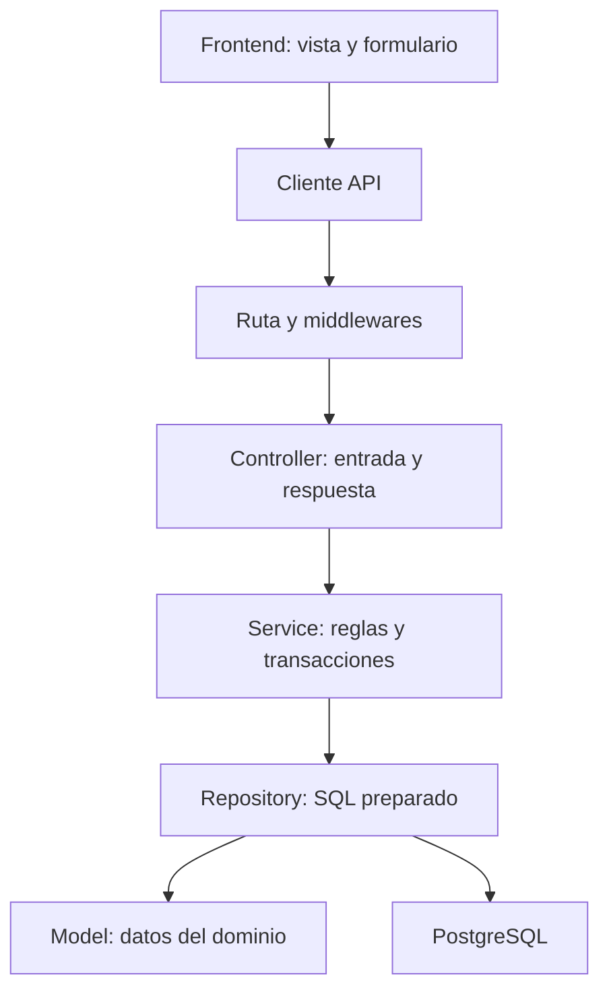

# Citas Medicas - Centro Medico Vida Salud

Sistema web para el proyecto academico de citas medicas, desarrollado con PHP y PostgreSQL.

La organizacion toma como referencia CADEFAR Inventory: backend, frontend y documentacion separados; cada capa tiene una responsabilidad y cada funcion expresa lo que hace. Esta entrega mantiene PHP y PostgreSQL, como pide el proyecto. No requiere Node.js, React, Sequelize, pnpm ni Composer.

## Estado actual: version 1

Esta es una primera entrega funcional de acceso y registro. No es todavia el sistema completo de citas.

| Modulo | Incluido en V1 |
| --- | --- |
| Autenticacion | Iniciar sesion, cerrar sesion, verificar cuenta activa y controlar inactividad |
| Roles | Administrador, Recepcionista, Medico y Paciente; catalogo fijo |
| Usuarios | Listar, buscar, crear cuentas administrativas, editar nombres/correo y activar/desactivar |
| Pacientes | Registro publico o desde recepcion, busqueda, detalle y actualizacion de contacto |
| Historia clinica | Creacion automatica al registrar un paciente; aun sin edicion clinica |
| Perfil personal | Cada paciente puede consultar solamente su propio perfil |
| Base de datos | Diseno inicial de las 11 tablas, claves foraneas e indices |
| Interfaz | Paginas adaptables a computadora y celular, mensajes de error y paginacion |

**Pendiente para los siguientes avances:** gestion de especialidades y medicos, horarios, turnos de 15 minutos, reserva/cancelacion de citas, consultas, tratamientos y reportes. La cuenta Medico puede iniciar sesion, pero su agenda aun no esta implementada.

Todos los nombres de archivos, comentarios, mensajes y textos incluidos se escribieron sin acentos. Los archivos usan UTF-8 sin BOM; los datos ingresados por las personas pueden contener caracteres Unicode.

## 1. Requisitos

| Herramienta | Uso |
| --- | --- |
| PHP 8.2 o posterior compatible | Ejecutar backend y frontend |
| Extensiones PDO, pdo_pgsql, mbstring, curl y session | Base de datos, textos y sesiones |
| PostgreSQL 15 o posterior compatible | Guardar los datos |
| pgAdmin o psql | Crear la base de datos |
| Git | Registrar los avances |
| VS Code y navegador moderno | Editar y revisar el proyecto |

En Windows puedes usar PHP incluido en XAMPP. Para esta V1 se arrancan dos servidores de desarrollo con PHP; no hace falta iniciar MySQL de XAMPP. PostgreSQL se instala y ejecuta por separado.

## 2. Estructura del proyecto

```text
citas-medicas/
|-- backend/
|   |-- .env.example
|   |-- scripts/
|   |   |-- verificar-entorno.php
|   |   |-- migrar-base-datos.php
|   |   `-- cargar-datos-iniciales.php
|   |-- public/
|   |   `-- index.php
|   |-- src/
|   |   |-- presentation/
|   |   |   |-- routes/
|   |   |   |-- middlewares/
|   |   |   `-- controllers/
|   |   |-- business/
|   |   |   |-- services/
|   |   |   `-- validators/
|   |   |-- data/
|   |   |   |-- config/
|   |   |   |-- models/
|   |   |   |-- repositories/
|   |   |   |-- migrations/
|   |   |   `-- seeders/
|   |   |-- shared/
|   |   |   |-- config/
|   |   |   |-- constants/
|   |   |   |-- errors/
|   |   |   `-- utils/
|   |   |-- bootstrap.php
|   |   |-- app.php
|   |   `-- server.php
|   `-- tests/
|-- frontend/
|   |-- .env.example
|   |-- public/
|   |   `-- index.php
|   `-- src/
|       |-- api/
|       |-- app/
|       |-- components/
|       |-- features/
|       |   |-- auth/
|       |   |-- inicio/
|       |   |-- panel/
|       |   |-- usuarios/
|       |   `-- pacientes/
|       |-- layouts/
|       |-- routes/
|       |-- styles/
|       `-- server.php
|-- docs/
|   `-- ai/
|       |-- contexto-proyecto.md
|       |-- arquitectura-y-nombres.md
|       |-- requisitos-y-reglas.md
|       |-- diccionario-datos.md
|       |-- api.md
|       |-- pruebas.md
|       `-- plan-avances-git.md
|-- .gitignore
`-- README.md
```

Los archivos de arranque se llaman `app.php` y `server.php` porque este proyecto usa PHP. No se incluyen `package.json` ni `.sequelizerc`: pertenecen al stack de CADEFAR y aqui no se utilizan.

## 3. Preparar el proyecto en Windows

Extrae el ZIP, abre la carpeta `citas-medicas` en VS Code y abre una terminal PowerShell dentro de ella. No copies esta V1 encima de otro proyecto: revisala primero en su propia carpeta.

Comprueba PHP:

```powershell
php -v
php --ini
```

Si Windows no reconoce `php`, agrega PHP de XAMPP al PATH de esa terminal:

```powershell
$env:Path += ";C:\xampp\php"
php -v
```

Repite ese ajuste en cada terminal nueva si todavia no lo agregaste al PATH de Windows.

En el archivo `php.ini` indicado por `php --ini`, habilita las extensiones que falten, quitando el `;` inicial. No dupliques las lineas:

```ini
extension=pdo_pgsql
extension=mbstring
extension=curl
```

Guarda y reinicia los procesos PHP que ya estuvieran abiertos. Verifica:

```powershell
php backend/scripts/verificar-entorno.php
```

## 4. Variables de entorno

Desde la raiz del proyecto:

```powershell
Copy-Item backend/.env.example backend/.env
Copy-Item frontend/.env.example frontend/.env
```

En Linux/macOS usa `cp` en lugar de `Copy-Item`.

Edita `backend/.env`:

```dotenv
APP_ENV=local
APP_TIMEZONE=America/La_Paz
FRONTEND_URL=http://127.0.0.1:8080
DB_HOST=127.0.0.1
DB_PORT=5432
DB_NAME=citas_medicas
DB_USER=postgres
DB_PASS=TU_CLAVE_DE_POSTGRESQL
DB_SSLMODE=prefer
SESSION_COOKIE_NAME=citas_medicas_sesion
SESSION_SECURE=false
SESSION_IDLE_SECONDS=1800
SEED_USERS_PASSWORD=TU_CLAVE_DE_PRUEBA_DE_12_O_MAS_CARACTERES
```

Reemplaza los dos valores de clave. `SEED_USERS_PASSWORD` debe tener entre 12 y 72 bytes. El seeder genera hashes con `password_hash`; no guarda esa clave en texto plano en la base.

En `frontend/.env`:

```dotenv
APP_ENV=local
APP_TIMEZONE=America/La_Paz
FRONTEND_URL=http://127.0.0.1:8080
API_URL=http://127.0.0.1:8000/api
SESSION_COOKIE_NAME=citas_medicas_sesion
```

Usa **127.0.0.1 en ambas aplicaciones**. No mezcles `localhost` y `127.0.0.1`, porque las cookies de sesion dependen del host. Las variables del sistema tienen prioridad sobre los archivos `.env`. No hay interpolacion de variables dentro de estos archivos.

## 5. Crear la base de datos

En pgAdmin, conectado a la base `postgres`, ejecuta esta sentencia por separado:

```sql
CREATE DATABASE citas_medicas WITH ENCODING 'UTF8';
```

Luego, desde la raiz del proyecto:

```powershell
php backend/scripts/verificar-entorno.php --conexion
php backend/scripts/migrar-base-datos.php
php backend/scripts/cargar-datos-iniciales.php
```

La migracion crea las 11 tablas dentro de una transaccion. Es una migracion inicial, no un gestor automatico de versiones: si las tablas existen, se detiene sin borrarlas. Los cambios posteriores se agregaran como nuevas migraciones.

El seeder requiere una base sin usuarios. Crea cuatro roles, tres especialidades, una cuenta por rol, el perfil medico de prueba y un paciente con historia clinica. Una segunda ejecucion se detiene; no reemplaza cuentas ni claves.

### Cuentas de prueba

| Rol | Correo |
| --- | --- |
| Administrador | `administrador@vidasalud.test` |
| Recepcionista | `recepcionista@vidasalud.test` |
| Medico | `medico@vidasalud.test` |
| Paciente | `paciente@vidasalud.test` |

La clave de las cuatro cuentas es el valor que elegiste en `SEED_USERS_PASSWORD`. Son datos ficticios para desarrollo local. Despues de cargar las cuentas, puedes vaciar esa variable en el archivo `.env`.

## 6. Ejecutar backend y frontend

Abre **dos terminales** en VS Code, desde la raiz del proyecto. Deja ambas abiertas.

Terminal 1: backend

```powershell
cd backend
php -S 127.0.0.1:8000 -t public src/server.php
```

Terminal 2: frontend

```powershell
cd frontend
php -S 127.0.0.1:8080 -t public src/server.php
```

| Servicio | Direccion |
| --- | --- |
| Portal | http://127.0.0.1:8080 |
| Inicio de sesion | http://127.0.0.1:8080/iniciar-sesion |
| Estado del backend | http://127.0.0.1:8000/api/estado |

`/api/estado` solo confirma que PHP y el router responden; no prueba la conexion a PostgreSQL. Para la conexion usa `verificar-entorno.php --conexion`.

Los servidores incorporados de PHP son para desarrollo local. El despliegue en nube requerira un servidor web con HTTPS, la carpeta publica correcta y configuracion de sesiones/origenes; no se publica con `php -S`.

## 7. Como revisar la primera version

1. Ingresa como Administrador y revisa Usuarios.
2. Crea una cuenta de Recepcionista.
3. Edita sus nombres o correo y prueba desactivar/activar esa cuenta.
4. Ingresa como Recepcionista y registra un paciente.
5. Abre su detalle: debe tener un numero de historia clinica.
6. Actualiza su telefono y contacto de emergencia.
7. Cierra sesion e ingresa como ese paciente.
8. Revisa Mi perfil. Esa cuenta no debe poder abrir Usuarios ni Pacientes.
9. Prueba el registro publico con un correo o CI repetido: debe rechazarlo sin crear datos incompletos.

La creacion de usuarios administrativos solo permite Administrador o Recepcionista. Los pacientes se crean desde su modulo. La gestion de cuentas de medicos se agrega en el siguiente avance.

## 8. Pruebas

Desde la raiz:

```powershell
php backend/tests/test_validaciones.php
php backend/tests/test_permisos.php
```

La prueba de integracion requiere una base PostgreSQL separada:

```powershell
php backend/tests/test_registro_paciente.php
```

Ese ultimo comando se rechaza si `DB_NAME` no termina en `_pruebas`. Sigue [la preparacion de pruebas](docs/ai/pruebas.md) antes de ejecutarlo.

La comprobacion incluida en esta entrega distingue las pruebas ejecutadas de las pendientes. Consulta ese documento para ver los resultados y las limitaciones del entorno de revision.

## 9. Como esta organizado el codigo



Ejemplos de nombres que explican su responsabilidad:

| Funcion | Responsabilidad |
| --- | --- |
| `obtenerUsuarioPorId` | Buscar una cuenta por identificador |
| `validarDatosRegistroPaciente` | Validar los datos del formulario |
| `registrarPacienteConHistoriaClinica` | Coordinar usuario, paciente e historia dentro de una transaccion |
| `crearHistoriaClinicaParaPaciente` | Insertar la historia asociada al paciente |
| `actualizarContactoPaciente` | Cambiar telefono, direccion y contacto de emergencia |
| `exigirRolPermitido` | Comprobar si la cuenta puede realizar la accion |

Los controladores no contienen SQL. Los repositorios no generan HTML. El frontend nunca recibe claves de PostgreSQL ni consulta la base directamente.

## 10. Subir este primer avance a Git

Si aun no existe un repositorio local, desde `citas-medicas`:

```powershell
git init
git branch -M main
git add .gitignore README.md backend frontend docs
git diff --cached --stat
git status
git commit -m "feat: agregar v1 con acceso por roles y registro de pacientes"
```

Antes del commit, `git status` no debe mostrar los archivos `.env`. Puedes comprobar la regla:

```powershell
git check-ignore backend/.env frontend/.env
```

Crea un repositorio remoto vacio y reemplaza `URL_DE_TU_REPOSITORIO` por su URL:

```powershell
git remote add origin URL_DE_TU_REPOSITORIO
git push -u origin main
```

Si ya tienes un repositorio, no repitas `git init` ni `git remote add`. Revisa `git status` y `git remote -v`, integra esta entrega en una rama y conserva tu historial. No uses `push --force`.

Esta V1 se puede registrar como un avance completo. Despues realiza un commit por cada cambio terminado y revisado. El [plan de avances](docs/ai/plan-avances-git.md) propone el orden para continuar.

## 11. Problemas frecuentes

| Mensaje o problema | Revision |
| --- | --- |
| `php` no se reconoce | Agrega la carpeta de PHP al PATH |
| Falta `pdo_pgsql` | Edita el php.ini indicado por `php --ini` |
| Error de conexion | Revisa servicio PostgreSQL, DB_HOST, DB_PORT, DB_USER, DB_PASS y DB_NAME |
| El formulario no conecta | Mantiene las dos terminales abiertas y revisa API_URL |
| El origen no esta permitido | FRONTEND_URL debe coincidir exactamente con el origen abierto |
| La sesion no permanece | Usa el mismo host en ambos puertos; SESSION_SECURE=false solo en HTTP local |
| Las tablas ya existen | No repitas la migracion inicial sobre la misma base |
| El seeder ya encuentra usuarios | No lo uses para cambiar claves ni para modificar cuentas existentes |

## Documentacion

- [Contexto del proyecto](docs/ai/contexto-proyecto.md)
- [Arquitectura y convenciones de nombres](docs/ai/arquitectura-y-nombres.md)
- [Requisitos y reglas de negocio](docs/ai/requisitos-y-reglas.md)
- [Diccionario de datos](docs/ai/diccionario-datos.md)
- [Rutas de la API](docs/ai/api.md)
- [Pruebas](docs/ai/pruebas.md)
- [Plan de avances en Git](docs/ai/plan-avances-git.md)

Referencias tecnicas: [PDO PostgreSQL](https://www.php.net/manual/en/ref.pdo-pgsql.php), [sesiones PHP](https://www.php.net/manual/en/features.session.security.management.php) y [servidor de desarrollo PHP](https://www.php.net/manual/en/features.commandline.webserver.php).
