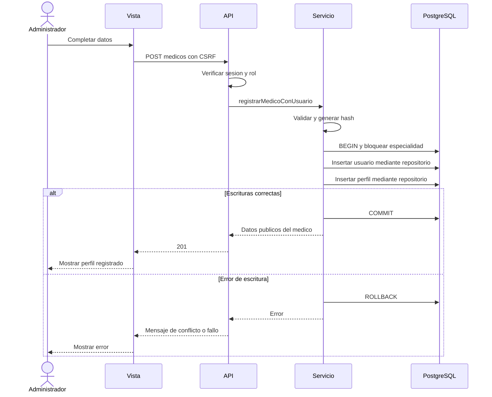

# Casos de uso: Especialidades y Medicos

## Alcance del avance

Actor principal: Administrador con cuenta activa y sesion vigente. Recepcionista, Medico y Paciente no tienen acceso a estos modulos de administracion.

| Caso | Accion | Resultado |
| --- | --- | --- |
| CU-EM-01 | Gestionar especialidades | Listar, buscar, crear y editar nombre/descripcion |
| CU-EM-02 | Cambiar estado de especialidad | Activar o desactivar segun los medicos asociados |
| CU-EM-03 | Registrar medico con usuario | Crear una cuenta de rol Medico y su perfil profesional |
| CU-EM-04 | Actualizar datos de medico | Modificar nombre, correo, matricula y especialidad |
| CU-EM-05 | Cambiar estado de medico | Cambiar acceso de la cuenta e invalidar sus sesiones anteriores |

## CU-EM-01: Gestionar especialidades

- Precondicion: sesion de Administrador y base actualizada con la migracion 002.
- Flujo: abrir Especialidades, buscar o seleccionar Nueva especialidad, completar nombre y descripcion opcional, enviar y revisar el resultado.
- Edicion: seleccionar Editar, corregir datos y guardar.
- Postcondicion: los datos validos quedan disponibles en el listado.
- Alternativas: nombre corto o demasiado largo se rechaza con 422; nombre equivalente existente, incluso inactivo, con 409; id inexistente con 404.
- No incluye eliminacion fisica.

## CU-EM-02: Cambiar estado de especialidad

- Precondicion: especialidad existente y Administrador autenticado.
- Flujo: seleccionar Activar o Desactivar en el listado y confirmar.
- El servicio bloquea la fila de la especialidad dentro de una transaccion.
- Para desactivar, cuenta sus medicos activos. Si existen, responde 409 y conserva el estado.
- Postcondicion: el nuevo estado queda guardado; una especialidad inactiva deja de aparecer entre las opciones para registrar medicos.

## CU-EM-03: Registrar medico con usuario

- Precondicion: especialidad activa; correo y matricula disponibles.
- Flujo: abrir Medicos, seleccionar Registrar medico, completar datos de acceso y profesionales, enviar el formulario.
- El servicio valida los datos, genera el hash y abre una transaccion.
- Bloquea la especialidad, comprueba su estado y registra el usuario con rol Medico.
- Registra el perfil asociado a ese usuario y confirma ambos registros juntos.
- Postcondicion: el medico aparece en el listado y puede iniciar sesion.
- Alternativas: datos invalidos 422; correo o matricula duplicados 409; especialidad inexistente 404; especialidad inactiva 409.
- Si falla una escritura, se revierte la transaccion y no queda una cuenta sin perfil medico.

## CU-EM-04: Actualizar datos de medico

- Precondicion: perfil existente y Administrador autenticado.
- Flujo: abrir Editar, cambiar los datos y guardar.
- Nombre/correo y perfil profesional se actualizan en una sola transaccion.
- Una nueva especialidad debe estar activa.
- Un medico inactivo puede conservar su especialidad actual inactiva al corregir otros datos.
- El rol y la clave de acceso no se cambian desde este formulario.
- Postcondicion: los datos de usuario y medico quedan consistentes o toda la operacion se revierte.

## CU-EM-05: Cambiar estado de medico

- Precondicion: Administrador autenticado y perfil existente.
- Flujo: seleccionar Activar o Desactivar en Medicos y confirmar.
- Activar exige una especialidad activa.
- El servicio actualiza usuarios.usuario_activo y aumenta version_credenciales cuando cambia el estado.
- Postcondicion: el acceso refleja el nuevo estado; las sesiones anteriores fallan en su siguiente solicitud.
- La ruta de cambio de estado de Usuarios rechaza cuentas medicas y dirige al modulo Medicos.

## Secuencia de registro de medico

El control de estados usa transacciones y bloqueo de la especialidad compartido por las operaciones relacionadas. La verificacion de concurrencia con varias conexiones nativas queda pendiente y no se confunde con las pruebas secuenciales del avance.
