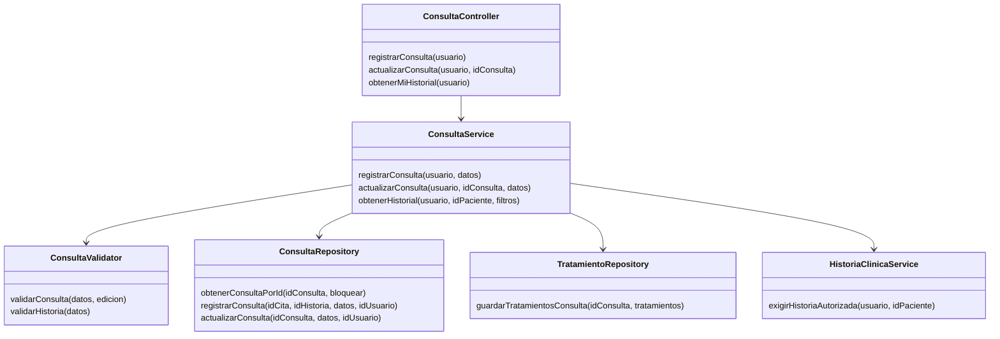
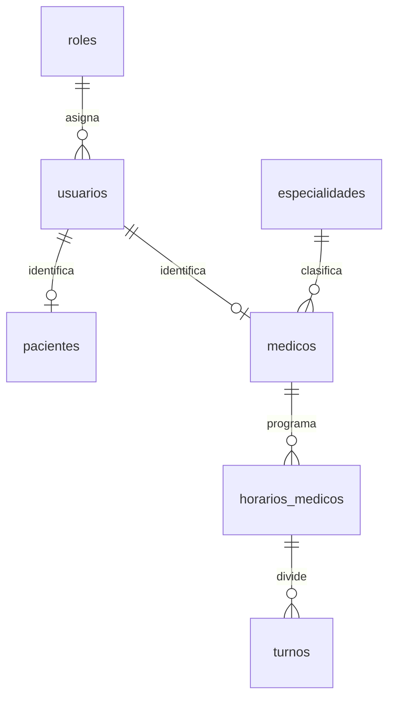
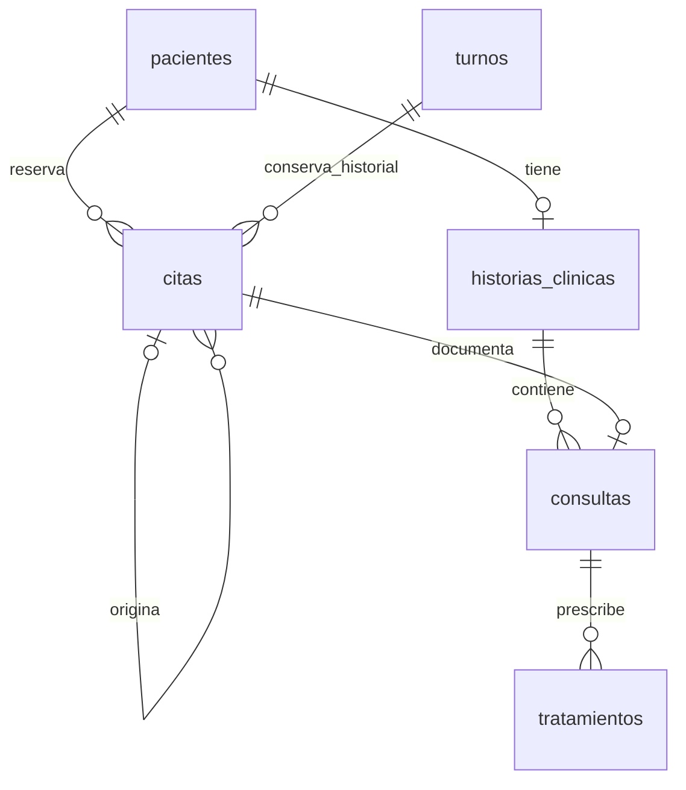
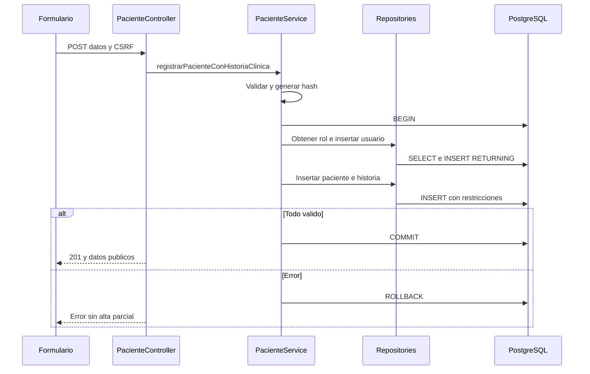
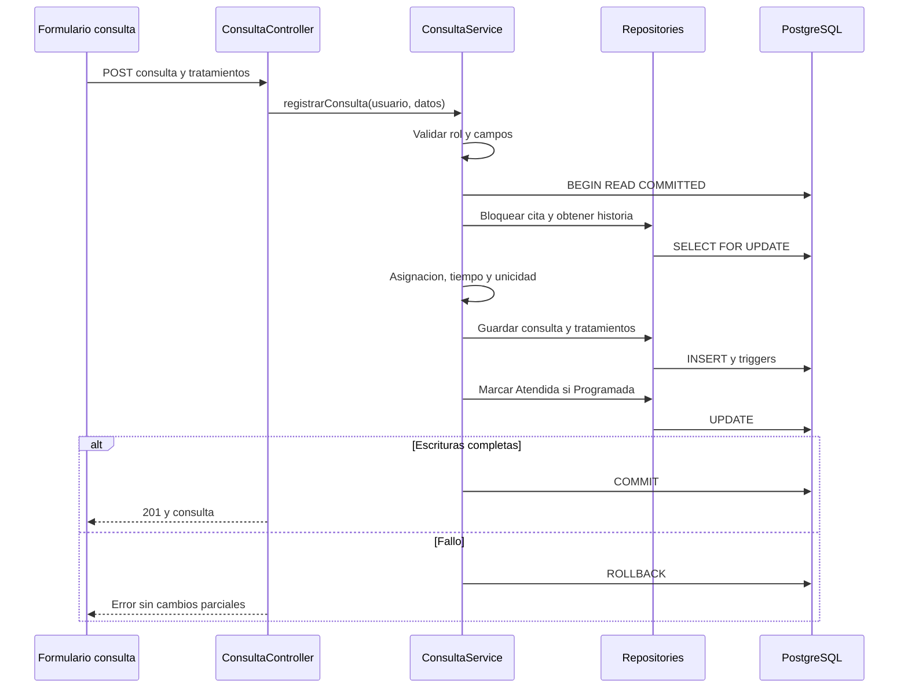
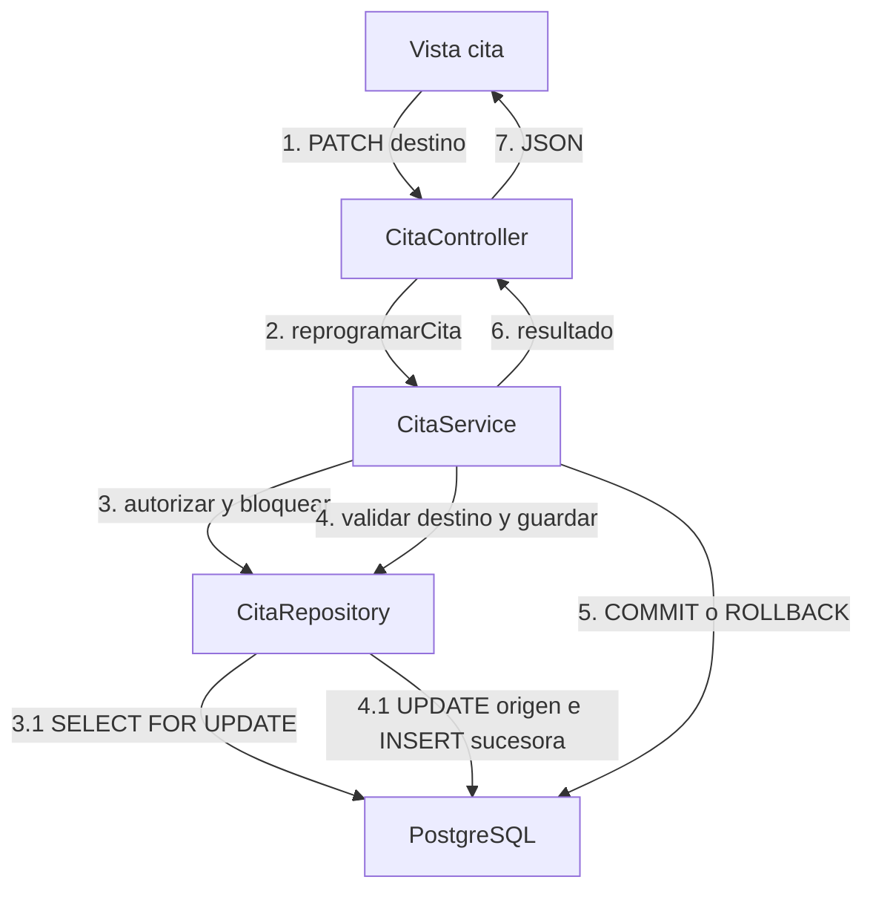
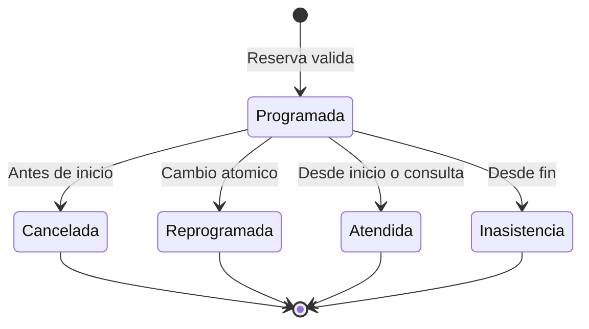

# Analisis y diseno

## Dominio y responsabilidades

Usuario y Rol resuelven identidad/acceso. Paciente y Medico son perfiles, Especialidad clasifica. HorarioMedico define un bloque y Turno un intervalo. Cita une paciente/turno y conserva resultados/reprogramaciones. HistoriaClinica agrupa consultas; Consulta documenta una cita y Tratamiento depende de ella. EventoBitacora representa trazabilidad administrativa. Se reutilizan las entidades existentes: no se inventa otro expediente o tabla de atencion.

| Tipo de clase | Responsabilidad |
| --- | --- |
| Frontera: vistas, JS, controllers | Interaccion y HTTP |
| Control: services/validators | Reglas y coordinacion del caso |
| Entidad: models | Datos del dominio y proyecciones publicas |
| Persistencia: repositories/conexion/transaccion | SQL y atomicidad |
| Transversal: permisos/sesion/CSRF/bitacora | Acceso y trazabilidad |

Figura focalizada en el caso clinico; el [catalogo completo](../ai/catalogo-metodos.md) contiene los metodos reales por clase.

## Modelo logico

Varias citas historicas pueden referirse al mismo turno; un indice parcial protege la ocupacion vigente. La cardinalidad fisica de historia es 0..1: una FK no obliga a insertar la hija, pero la transaccion de registro cumple la regla de historia obligatoria. Bitacora guarda ID/nombre/rol del actor como instantanea sin FK de actor. Relaciones adicionales a usuario responsable y especialidad de reserva estan en el diccionario.

## Diseno fisico

Tras 001-008: doce tablas, 93 columnas. Claves bigint con identidad; tipos timestamp/timestamptz segun el esquema existente; JSONB para historiales/versiones. La conexion establece hora de Bolivia. El [diccionario](../ai/diccionario-datos.md) se extrae del esquema migrado, con nulabilidad, defaults, restricciones e indices. El SQL educativo crea el estado final en una BD vacia; las migraciones actualizan instalaciones existentes.

## Secuencia: registro completo

## Secuencia: consulta

## Comunicacion: reprogramar

El resumen omite repositorios auxiliares de medico/especialidad/paciente/turno usados al preparar destino; no existe escritura directa desde vista a BD.

## Estados

Reprogramar crea otra entidad Programada. No vuelve la misma fila al inicio ni hay estado operativo Confirmada.
