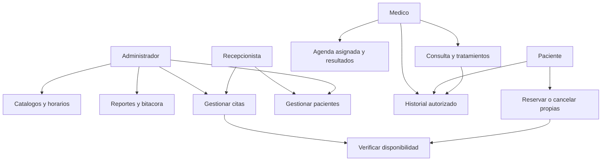

# Casos de uso

Se conservan los identificadores previos. CU-32 a CU-35 y CU-40 se completan en 1.5; CU-33 incorpora lectura propia del paciente. CU-43 Confirmar se retira; nuevas reservas quedan Programadas y el endpoint anterior responde 404.

| ID | Caso y actores | Estado |
| --- | --- | --- |
| CU-01/02 | Iniciar/cerrar sesion; cuenta activa | Implementado |
| CU-03/04 | Registro publico/interno de paciente; visitante o Admin/Recepcion | Implementado |
| CU-05/06/07 | Buscar, editar/activar paciente y perfil propio | Implementado |
| CU-08 a 11 | Crear, consultar, editar y activar usuario; Admin | Implementado |
| CU-12 a 15 | Gestion de especialidades; Admin | Implementado |
| CU-16 a 19 | Gestion de medicos; Admin | Implementado |
| CU-20/21 | Programar y consultar horarios; Admin/Medico segun accion | Implementado |
| CU-22 | Disponibilidad; Admin/Recepcion/Paciente | Implementado |
| CU-23/24 | Reserva propia o para paciente; Paciente o Admin/Recepcion | Implementado |
| CU-25 | Detalle/citas; cuatro roles con alcance | Implementado |
| CU-26 | Cancelar; cuatro roles con alcance y tiempo | Implementado |
| CU-27 | Reprogramar; Admin/Recepcion | Implementado |
| CU-28/29 | Atendida/Inasistencia; Admin/Recepcion/Medico asignado | Implementado |
| CU-30 | Agenda y datos basicos; Medico | Implementado |
| CU-31 | Editar/retirar bloques | Pendiente |
| CU-32/35 | Registrar/corregir consulta y tratamientos; Medico asignado | Completado |
| CU-33/34 | Leer historial / actualizar antecedentes; Medico asignado, lectura propia Paciente | Completado |
| CU-36 | Reportes; Admin | Implementado |
| CU-37 a 39 | Cambio de clave, recuperacion, reasignacion de rol | Pendiente |
| CU-40 | Bitacora; Admin | Completado |
| CU-41/42 | Consultorios/laboratorio | Fuera de alcance |
| CU-43 | Confirmar cita | Retirado |

## Especificaciones principales

**CU-01.** Precondicion: cuenta activa. Ingresar credenciales, validar, verificar hash, renovar sesion, registrar evento y cargar panel. Credenciales incorrectas/inactiva: 401; escritura sin CSRF: 419. Resultado: acceso limitado, sin devolver hash. Un rechazo genera evento generico sin copiar correo/clave enviados.

**CU-03/04.** Precondicion: entrada valida, CI/correo disponibles; registro interno exige permiso. Validar, generar hash, abrir transaccion, obtener rol Paciente, insertar usuario/paciente/historia y confirmar. Duplicado: 409 y rollback sin usuario huerfano. Resultado: las tres entidades existen juntas. Evidencia: test_registro_paciente.php.

**CU-20.** Admin elige medico, fechas, dias y horas. Hasta 366 dias y horizonte permitido; medico/especialidad activos. Bloquear, evaluar fechas, conservar equivalentes, informar cruces y generar turnos validos. Fecha pasada se omite; error SQL revierte lote. 08:00-09:00 genera dos intervalos de 30. Evidencia: test_programacion_periodos y test_transacciones_capas.

**CU-23/24.** Paciente propio o Admin/Recepcion identifica paciente activo; elige especialidad/medico/fecha/turno y motivo opcional. En transaccion se bloquean entidades y se revalida tiempo, disponibilidad, cruces y ausencia de otra Programada. Conflicto: 409; propietario no autorizado: 404. Resultado: reserva Programada con responsable. Concurrencia nativa: test_reserva_concurrente, pendiente de repetir en Windows.

**CU-26.** Programada futura y asistencia pendiente. Autoriza propietario/medico asignado/Admin/Recepcion, pide motivo obligatorio para medico, cambia Cancelada y conserva evento. Inicio alcanzado o estado final: 409. Resultado: turno liberado si sigue futuro. No existe ventana adicional de 24 horas.

**CU-27.** Admin/Recepcion, origen Programada futura y destino distinto/disponible. Valida destino, marca origen Reprogramada, inserta nueva Programada con id_cita_origen y confirma juntos. Fallo revierte ambos. Detalle del origen muestra ultimo destino mediante CTE con proteccion contra ciclos.

**CU-28/29.** Medico asignado o Admin/Recepcion; Programada sin resultado. Atendida desde inicio o Inasistencia desde fin, con asistencia y responsable. Antes de hora o resultado repetido: 409. No crea diagnostico ni permite corregir un resultado final.

**CU-32/35.** Medico asignado, cita iniciada Programada/Atendida. Completa motivo, diagnostico y hasta 20 tratamientos; se bloquea cita, valida unicidad e historia del mismo paciente, inserta todo y marca Atendida si era Programada. Duplicado 409, ajena 404, otro rol 403, IDs falsificados 422. Un fallo de tratamiento revierte consulta, cita y auditoria. Edicion exige versionConsulta; trigger conserva consulta/tratamientos previos. Version vieja: 409; no se traslada ni borra la consulta.

**CU-33/34.** Paciente propio o Medico con cita Programada/Atendida del paciente. Resolver alcance, devolver antecedentes y lista paginada, abrir consulta y registrar lectura generica. Solo medico edita sangre/alergias/antecedentes con versionHistoria. Admin/Recepcion: 403; ajeno: 404; version antigua: 409. Se conservan versiones previas.

**CU-36.** Admin filtra periodo, medico, especialidad y estado. Validator comprueba rango; servicio obtiene metricas y detalle en lectura consistente. Rango invalido: 422; otro rol: 403. No devuelve contenido clinico.

**CU-40.** Admin abre Bitacora, filtra fecha/usuario/modulo/accion/texto y pagina de 20 en 20. Otros roles: 403. No hay rutas de escritura de eventos. Mutaciones revertidas no figuran como exitosas; no se promete registrar cada rechazo HTTP o acciones anteriores a instalar 007.
